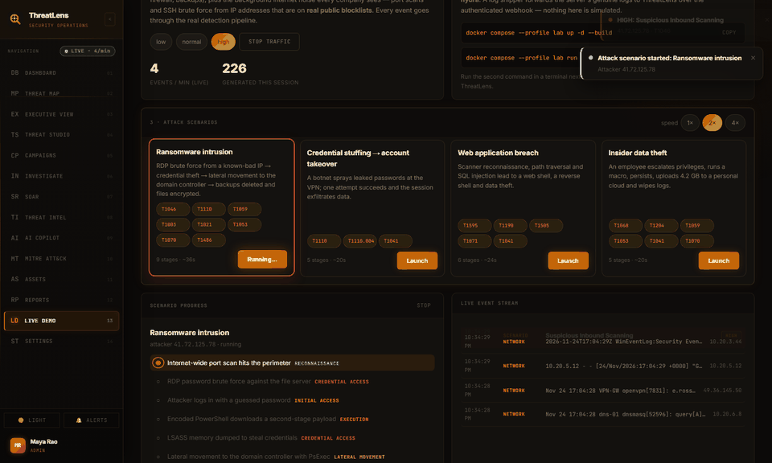
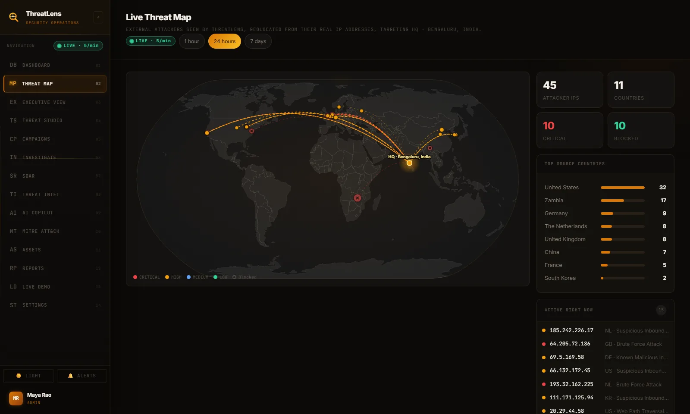
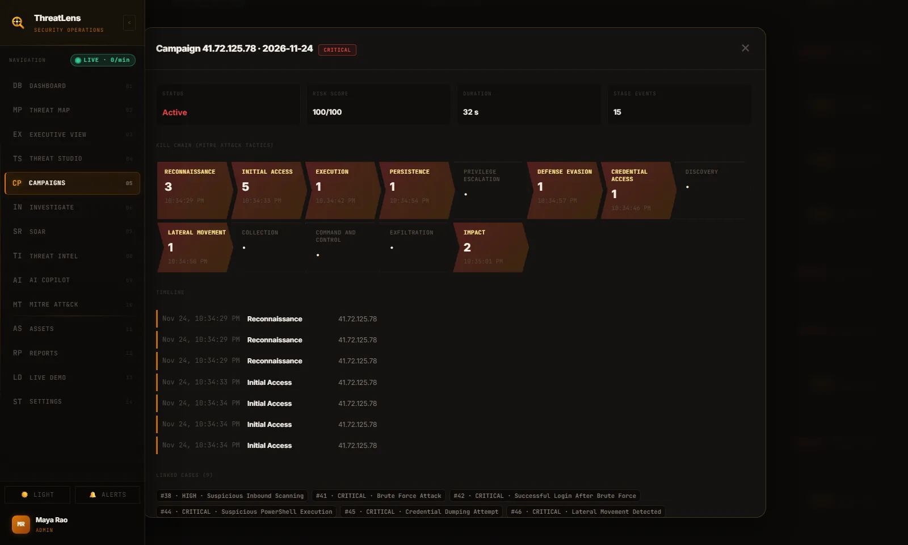
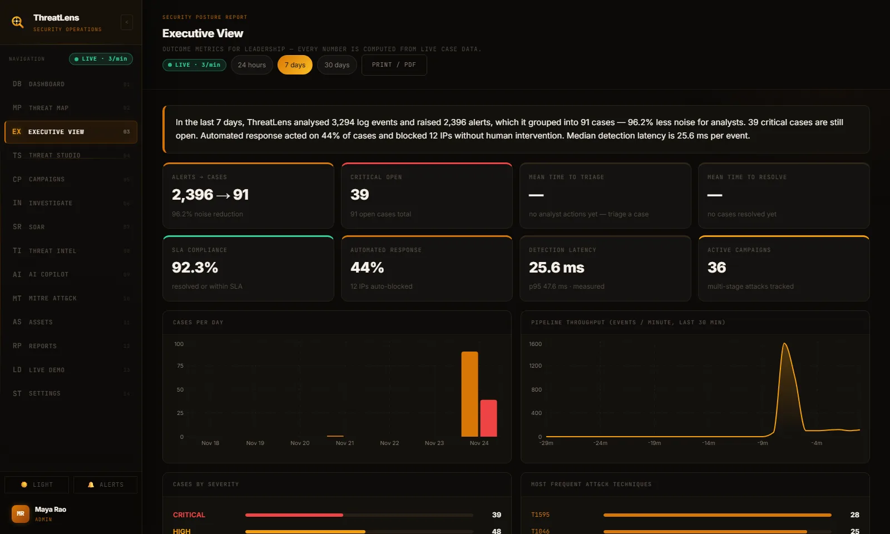
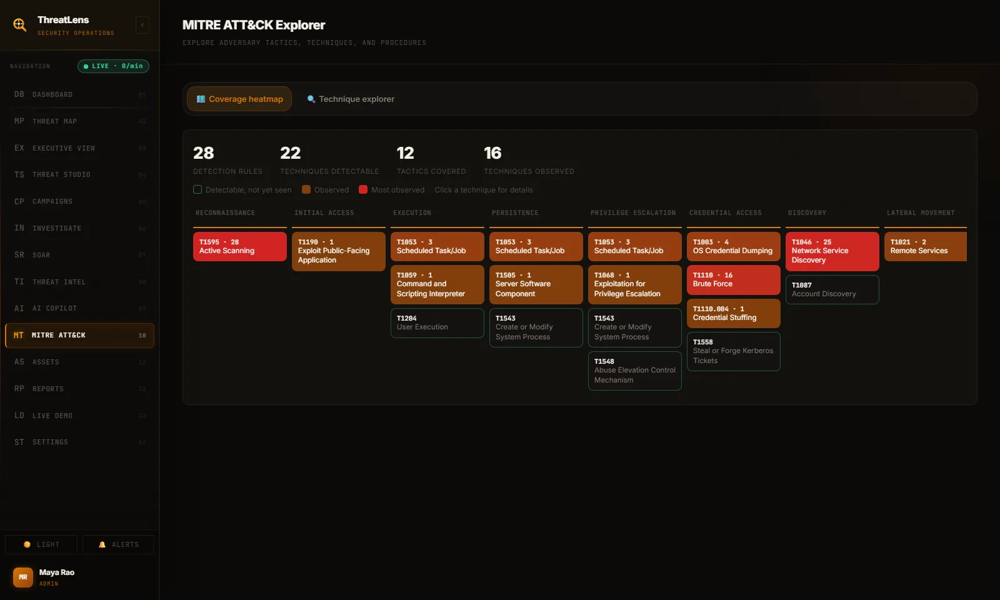
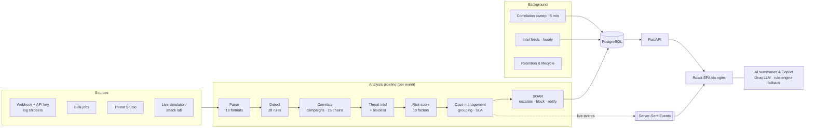

# ThreatLens

**AI-assisted security operations platform.** ThreatLens ingests raw logs from servers, firewalls,
proxies and cloud platforms, detects attacks with MITRE ATT&CK–mapped rules, links every step of an
intrusion into one campaign, explains its risk score, responds automatically with SOAR rules, and
answers analysts' questions through an AI copilot — all updating live in the browser.



| | |
|---|---|
|  |  |
| **Live Threat Map** — real attacker IPs, geolocated, streamed as they arrive | **Campaign kill chain** — every stage of an intrusion linked into one story |
|  |  |
| **Executive View** — triage/resolve times, SLA, noise reduction, automation | **ATT&CK coverage heatmap** — what is detectable and what was seen |

## Measured, not claimed

| Metric | Result | Reproduce |
|---|---|---|
| Detection on real attacks | **93 of 261** recordings in the public [EVTX-ATTACK-SAMPLES](https://github.com/sbousseaden/EVTX-ATTACK-SAMPLES) dataset (36 %) — privilege escalation 48 %, credential access 44 % | `python -m benchmarks.evtx_validation --download` |
| Pipeline throughput | **~93 events/s per worker**, p50 **9 ms**, p95 **23 ms** per event on PostgreSQL (laptop, Docker) | `python -m benchmarks.throughput` |
| Real attack lab | nmap, sqlmap and hydra against a real server → scan, SQL injection, brute force, compromise and auto-block all detected | `docker compose --profile lab run --rm attacker all` |
| Automated tests | 69 backend (API, detection, live layer) + 9 frontend, run in CI on every push | `pytest` · `npm test` |

---

## Quick start

Requirements: Docker Desktop.

```bash
git clone https://github.com/kritikGianta/ThreatLens.git
cd ThreatLens
cp .env.example .env            # Windows PowerShell: Copy-Item .env.example .env
#   → set JWT_SECRET and POSTGRES_PASSWORD; add API keys whenever you have them
docker compose --profile lab up -d --build
```

Open **http://localhost:8080** and create an account — the first account becomes the admin.
Then go to **Live Demo**, start the background traffic and launch an attack scenario.

| URL | What |
|---|---|
| http://localhost:8080 | ThreatLens web app |
| http://localhost:8080/docs | Interactive API docs (Swagger) |
| http://localhost:8000/ready | Backend readiness probe (localhost only, `BACKEND_PORT`) |

Presenting it? Follow **[docs/DEMO_GUIDE.md](docs/DEMO_GUIDE.md)** — a timed 7-minute demo script,
answers to the questions judges ask, and troubleshooting.

## Three ways to see it work

1. **Live traffic** — a simulated company network (logons, web, DNS, firewall, backups) plus real-world
   internet noise from IP addresses on public blocklists, streamed through the real pipeline.
2. **Attack scenarios** — one click launches a multi-stage intrusion (ransomware, credential stuffing,
   web application breach, insider data theft) that unfolds stage by stage.
3. **The attack lab** — a deliberately weak Linux server and an attacker container on an isolated
   Docker network. Real tools generate real logs, forwarded by a log shipper over the authenticated
   webhook:
   ```bash
   docker compose --profile lab up -d --build
   docker compose --profile lab run --rm attacker all   # or: recon | web | bruteforce | post | exfil
   ```

## Architecture



| Layer | Technology |
|---|---|
| API | Python 3.12 · FastAPI · SQLAlchemy 2 · Alembic · APScheduler |
| Database | PostgreSQL 16 (SQLite for zero-setup local dev and tests) |
| Real time | Server-Sent Events with single-use stream tickets |
| Frontend | React 18 · MUI · Recharts · d3-geo · Framer Motion, served by nginx |
| AI | Groq LLM (optional) with a deterministic rule-engine fallback |
| Intel | CISA KEV · abuse.ch Feodo Tracker · IPsum · URLhaus · ThreatFox · NIST NVD · VirusTotal |
| Ops | Docker Compose · GitHub Actions CI · structured logs · health/readiness probes |

## Features

- **Hybrid parser** — 13 formats (Windows Event Log, Linux/SSH, Cisco ASA, Palo Alto, Snort/Suricata,
  firewall, proxy, CloudTrail, Azure, GCP, web server, DNS, syslog); URL-decoding; optional LLM fallback.
- **Context-aware detection** — 28 MITRE-mapped rules where every match fires: brute force and
  successful login after brute force, credential dumping (LSASS, DCSync, Kerberoasting, SAM/NTDS),
  encoded PowerShell, Office macro execution, living-off-the-land binaries, UAC bypass, suspicious
  services, admin-share lateral movement, persistence, log clearing, C2 and reverse shells, ransomware,
  exfiltration (tool or volume based), SQL injection, path traversal, web shells, scanning and AD discovery.
- **Campaign correlation** — events from one attacker link into a campaign that never times out;
  15 attack-chain patterns raise confidence; a 5-minute sweep finds slow and distributed brute force.
- **Transparent risk** — 0–100 score from 10 factors, every point itemised on the case.
- **Threat intelligence** — five feeds refreshed hourly; every log is cross-checked automatically.
- **Case management** — repeat alerts grouped into cases, workflow states, owners, notes, SLA timers,
  auto-reopen / auto-close, evidence trail, Markdown incident and operations reports.
- **SOAR** — severity / threat-type / multi-stage rules that escalate, block, call webhooks or e-mail,
  re-evaluated when a case escalates and recorded in the audit log.
- **Live operations** — real-time event stream, alert toasts, live threat map, executive KPIs,
  ATT&CK coverage heatmap, kill-chain view and a presenter control panel.
- **AI SOC Copilot** — answers grounded in the live database, with per-user conversation memory.
- **Enterprise controls** — JWT with refresh tokens, admin / analyst / viewer roles, user management,
  immutable audit log, rate limiting, request IDs, security headers, SSRF guard, migrations, probes,
  and a read-only demo account for visitors.

Detailed walkthroughs: [Features](docs/FEATURES.md) · [Feature validation](docs/FEATURE_VALIDATION_GUIDE.md) ·
[Testing](docs/TESTING_GUIDE.md) · [Demo guide](docs/DEMO_GUIDE.md)

## API keys

Every integration is optional. `.env.example` explains where to get each key; **Settings →
Integrations** shows which are active.

| Variable | Enables |
|---|---|
| `GROQ_API_KEY` | AI-written incident analysis, conversational Copilot, LLM log-parsing fallback |
| `VT_API_KEY` | VirusTotal IP reputation |
| `NVD_API_KEY` | Higher NVD rate limit for CVE enrichment |
| `ABUSECH_AUTH_KEY` | URLhaus and ThreatFox feeds |
| `IPINFO_TOKEN`, `OPENCAGE_API_KEY` | Fallback / richer geolocation |
| `SMTP_*` | E-mail actions in SOAR rules |
| `INGEST_API_KEY` | Machine log forwarding to the webhook (auto-generated) |
| `DEMO_VIEWER_PASSWORD` | Read-only `judge` account for visitors |

## Forwarding real logs

```bash
curl -X POST http://localhost:8080/api/v1/logs/webhook \
  -H "X-API-Key: $INGEST_API_KEY" -H "Content-Type: application/json" \
  -d '{"source": "linux-auth", "logs": ["sshd[812]: Failed password for root from 198.51.100.7 port 22 ssh2"]}'
```

Any shipper that can POST JSON works (Filebeat, Fluent Bit, Vector, a cron script) — `lab/shipper`
is a complete 100-line example.

## Local development

```bash
docker compose up -d db                       # or skip and use SQLite (leave DATABASE_URL unset)
cd backend && python -m venv .venv && .venv/Scripts/activate && pip install -r requirements-dev.txt
uvicorn main:app --reload --port 8000         # API
cd ../frontend && npm ci && npm start         # UI on http://localhost:3000 (proxies /api to :8000)
```

## Repository layout

```
backend/     FastAPI service — routers/, services/ (pipeline, detection, simulator, intel, SOAR…),
             core/ (events, telemetry, LLM, HTTP), models/, migrations/, tests/, benchmarks/
frontend/    React SPA + nginx config
lab/         Attack lab: victim server, attacker toolkit, log shipper
docs/        Demo guide, feature, validation and testing guides, screenshots
```

## Security notes

- Set a strong `JWT_SECRET`; with `ENVIRONMENT=production` the API refuses to start without one.
- Set `ALLOW_PUBLIC_SIGNUP=false` once your team is onboarded.
- The attack lab is deliberately vulnerable: keep it on its isolated Docker network and never publish
  its ports.
- Demo data uses RFC 5737 documentation addresses and IPs from public blocklists; no traffic is ever
  sent to them.
