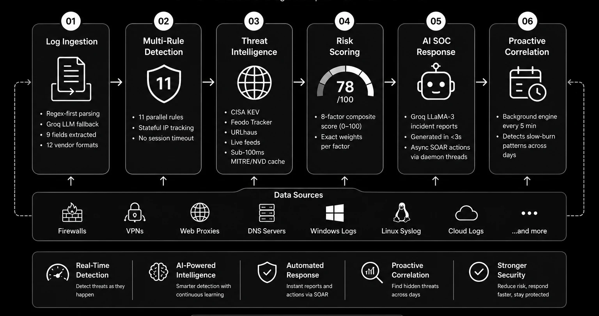

# ThreatLens

**AI-powered security operations platform** — ingest raw logs from any source, detect and correlate
multi-stage attacks, enrich them with live threat intelligence and MITRE ATT&CK, automate response
with SOAR rules, and investigate with an AI SOC copilot.



| Layer | Technology |
|---|---|
| API | Python 3.12 · FastAPI · SQLAlchemy 2 · Alembic · APScheduler |
| Database | PostgreSQL 16 (SQLite for zero-setup local dev and tests) |
| Frontend | React 18 · MUI · Recharts · Leaflet · Framer Motion, served by nginx |
| AI | Groq LLM (optional) with a deterministic rule-engine fallback |
| Intel | CISA KEV · abuse.ch Feodo Tracker · IPsum · URLhaus · ThreatFox · NIST NVD · VirusTotal |
| Ops | Docker Compose · GitHub Actions CI · structured logs · health/readiness probes |

---

## Quick start (Docker — recommended)

Requirements: Docker Desktop.

```bash
git clone https://github.com/kritikGianta/ThreatLens.git
cd ThreatLens
cp .env.example .env            # Windows PowerShell: Copy-Item .env.example .env
#   → set JWT_SECRET and POSTGRES_PASSWORD; add API keys whenever you have them
docker compose up -d --build
```

| URL | What |
|---|---|
| http://localhost:8080 | ThreatLens web app |
| http://localhost:8080/docs | Interactive API docs (Swagger) |
| http://localhost:8000/ready | Backend readiness probe (localhost only) |
| `localhost:5432` | PostgreSQL (localhost only) |

The **first account you sign up becomes the admin**. On first start the backend migrates the
database, seeds a realistic multi-stage attack scenario, and pulls threat-intel feeds in the
background — so every page has data immediately.

```bash
docker compose logs -f backend     # follow API logs
docker compose down                # stop (data is kept in the pgdata volume)
docker compose down -v             # stop and wipe the database
```

## API keys

Every integration is optional — ThreatLens is fully functional with none of them. `.env.example`
documents each key with step-by-step instructions for obtaining it; **Settings → Integrations** in
the app shows which ones are active.

| Variable | Enables | Free tier |
|---|---|---|
| `GROQ_API_KEY` | AI-written SOC summaries, conversational Copilot, LLM log-parsing fallback | yes |
| `VT_API_KEY` | VirusTotal IP reputation in analysis and risk scoring | yes |
| `NVD_API_KEY` | Higher NVD rate limit for CVE enrichment | yes |
| `ABUSECH_AUTH_KEY` | URLhaus and ThreatFox feeds | yes |
| `IPINFO_TOKEN`, `OPENCAGE_API_KEY` | Fallback / richer IP geolocation | yes |
| `SMTP_*` | E-mail actions in SOAR rules | — |
| `INGEST_API_KEY` | Machine-to-machine log forwarding to the webhook | self-generated |

After editing `.env`, apply it with `docker compose up -d` (the backend restarts with the new values).

## Local development (without Docker for the app)

```bash
# Database (or skip this and use SQLite — leave DATABASE_URL unset)
docker compose up -d db

# Backend — http://localhost:8000
cd backend
python -m venv .venv
.venv/Scripts/activate              # macOS/Linux: source .venv/bin/activate
pip install -r requirements-dev.txt
# point at the dockerised DB (or omit for SQLite):
#   DATABASE_URL=postgresql+psycopg://threatlens:<POSTGRES_PASSWORD>@localhost:5432/threatlens
uvicorn main:app --reload --port 8000

# Frontend — http://localhost:3000 (proxies /api to :8000)
cd frontend
npm ci
npm start
```

## Features

- **Hybrid log parser** — regex extraction for 12+ formats (Windows, Linux/SSH, Cisco ASA, Palo Alto,
  Snort/Suricata, firewalls, CloudTrail, Azure, GCP, web servers, DNS, syslog) with LLM fallback.
- **Multi-rule detection** — 16 rules across the kill chain (brute force, successful login after brute
  force, credential dumping, encoded PowerShell, lateral movement, persistence, log clearing, C2,
  exfiltration incl. volume-based, SQL injection, web shells, scanning…); every matching rule fires.
- **Campaign correlation** — events from the same source are linked into campaigns with no time-out;
  13 attack-chain patterns (e.g. *Breach → Credential Theft → Lateral Spread*) boost risk.
- **Transparent risk scoring** — 0–100 score from confidence, technique impact, campaign depth,
  CVSS, VirusTotal, blocklist and IOC matches; every factor is shown to the analyst.
- **Threat intelligence** — scheduled ingestion from five feeds, automatic IOC cross-referencing on
  every log, TF-IDF retrieval over a curated knowledge base plus CVE/IOC descriptions (RAG).
- **Case management** — grouping of repeat alerts into cases, workflow states, owners, notes, SLA
  timers and breach tracking, auto-reopen and auto-close, evidence trail, Markdown incident and operations reports.
- **SOAR** — rules on severity / threat type / multi-stage conditions with webhook (Slack, Teams…),
  e-mail, auto-block and escalation actions; firewall-ready blocklist export.
- **Background correlation engine** — slow (multi-day) brute force, distributed attacks on one
  account, campaign escalation, dormancy, repeat-offender auto-block.
- **AI SOC Copilot** — questions answered from live database context with per-user conversation
  memory.
- **MITRE ATT&CK explorer** — 700+ techniques with tactics, platforms, detection guidance,
  sub-techniques and incidents observed in your environment.
- **Enterprise controls** — JWT auth with refresh tokens, roles (admin / analyst / viewer),
  user management, immutable audit log, rate limiting, request IDs, security headers, SSRF guard on
  asset checks, PostgreSQL migrations, health & readiness probes.

Detailed walkthroughs: [docs/FEATURES.md](docs/FEATURES.md) ·
[docs/FEATURE_VALIDATION_GUIDE.md](docs/FEATURE_VALIDATION_GUIDE.md) ·
[docs/TESTING_GUIDE.md](docs/TESTING_GUIDE.md)

## Forwarding logs

```bash
curl -X POST http://localhost:8080/api/v1/logs/webhook \
  -H "X-API-Key: $INGEST_API_KEY" -H "Content-Type: application/json" \
  -d '{"source": "linux-auth", "logs": ["sshd[812]: Failed password for root from 198.51.100.7 port 22 ssh2"]}'
```

Up to 500 lines per request; `POST /api/v1/analysis/ingest` accepts 1,000 lines as an asynchronous job.

## Repository layout

```
backend/        FastAPI service — routers/, services/ (pipeline, detection, intel, SOAR…),
                models/, migrations/ (Alembic), tests/ (pytest)
frontend/       React SPA + nginx config
docs/           feature, validation and testing guides
docker-compose.yml · .env.example · .github/workflows/ci.yml
```

## Testing

```bash
cd backend  && python -m pytest          # 52 API + detection tests (SQLite, no network)
cd frontend && npm run lint && npm test  # ESLint (zero warnings) + Jest
```

CI runs both suites, verifies Alembic migrations against PostgreSQL, builds the production bundle
and the Docker images on every push and pull request.

## Security notes

- Set a strong `JWT_SECRET`; with `ENVIRONMENT=production` the API refuses to start without one.
- Set `ALLOW_PUBLIC_SIGNUP=false` once your team is onboarded; admins create accounts under
  **Settings → Users**.
- PostgreSQL and the direct API port are bound to `127.0.0.1` by default; expose only port 8080
  (ideally behind TLS) when deploying.
- The demo scenario uses RFC 5737 documentation IP ranges (192.0.2.0/24, 198.51.100.0/24,
  203.0.113.0/24); disable it with `SEED_DEMO_DATA=false`.
